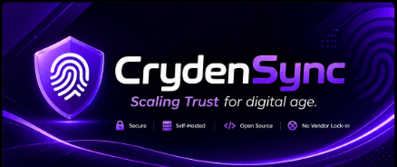
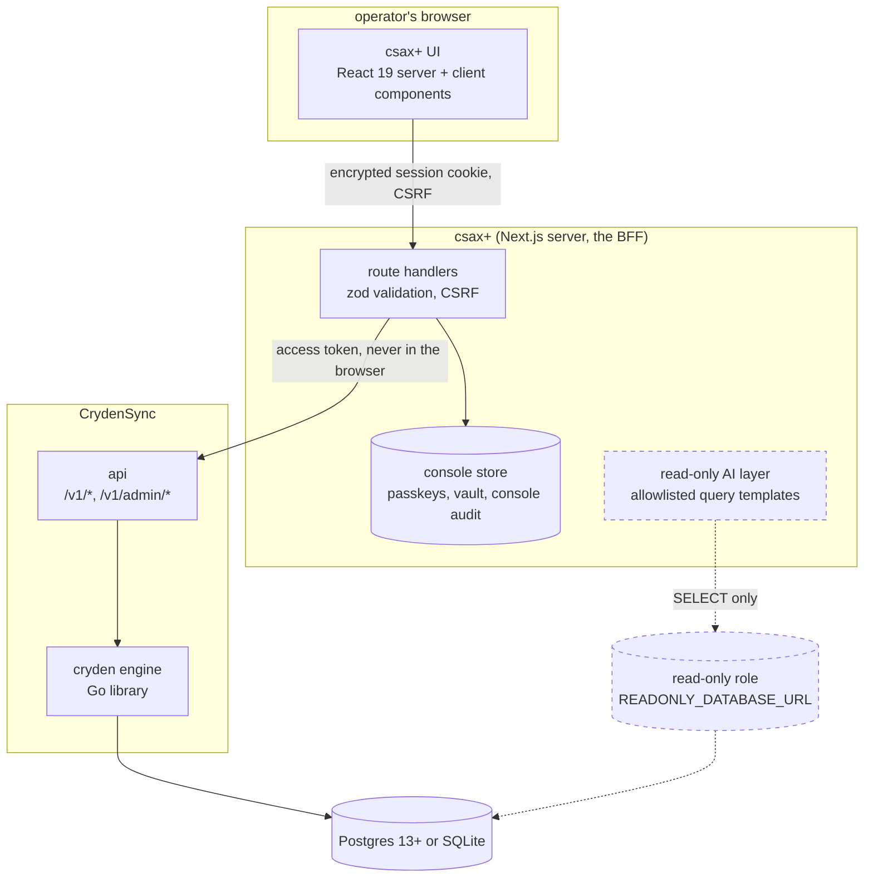
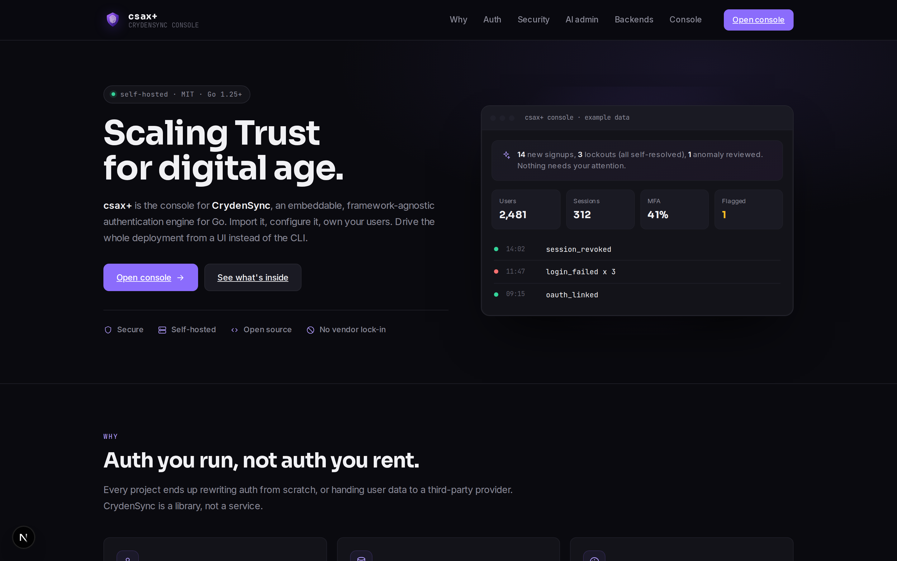
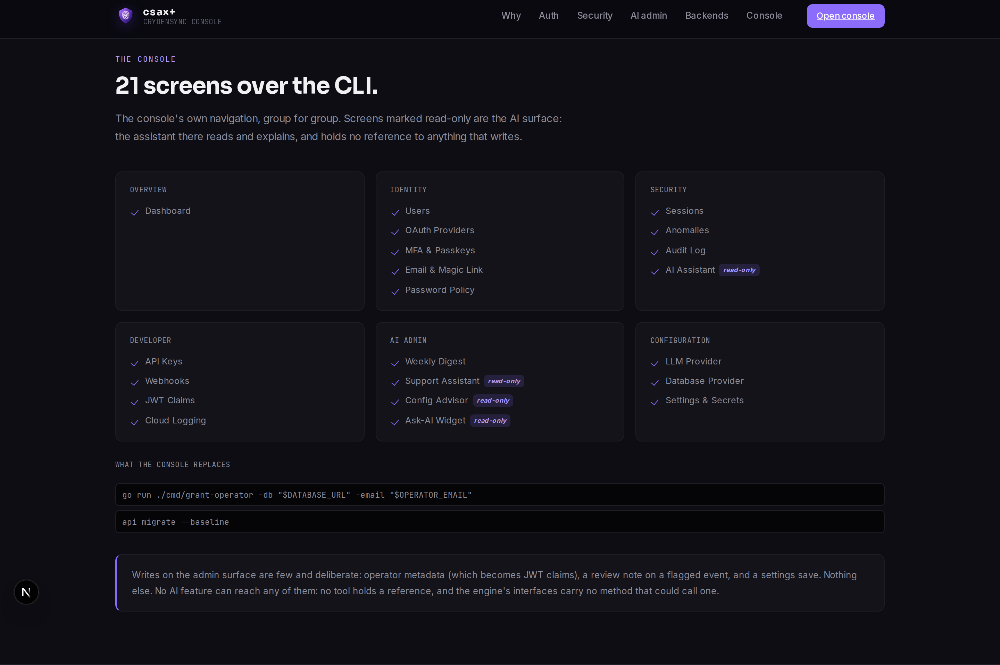
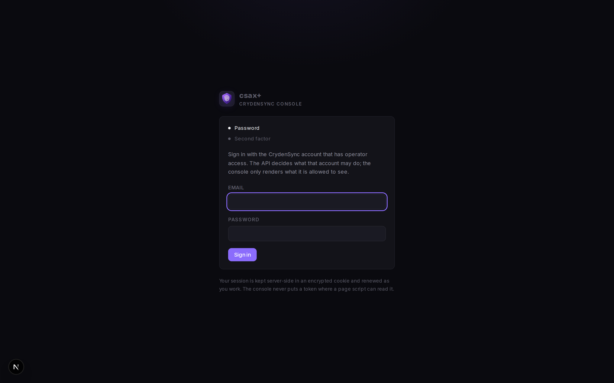
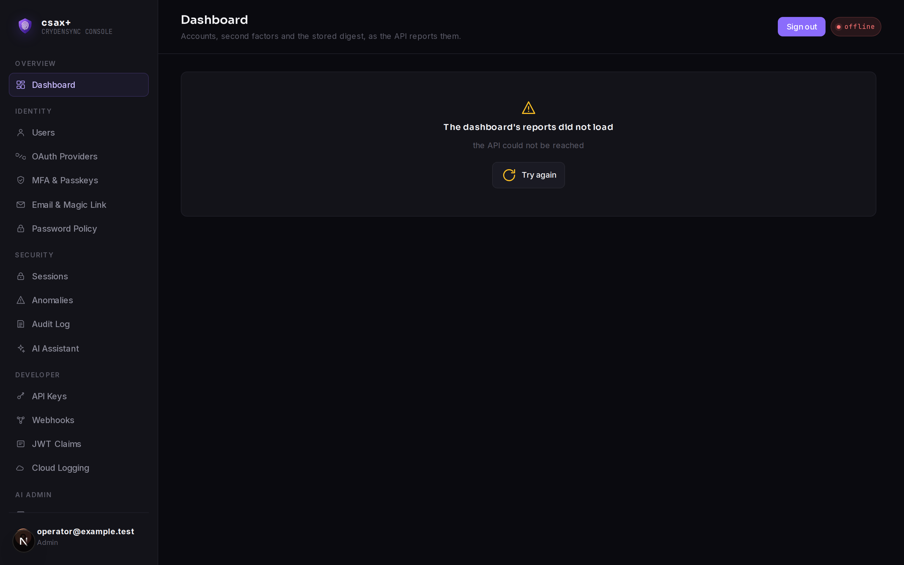
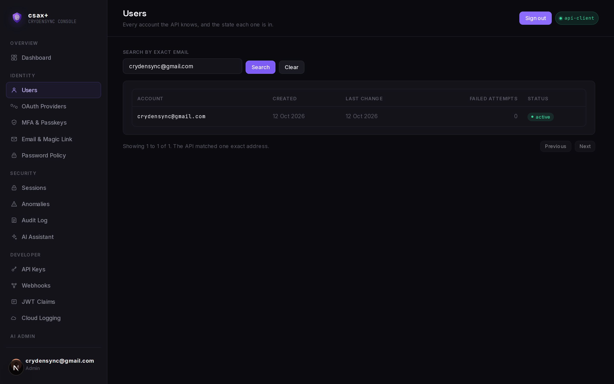
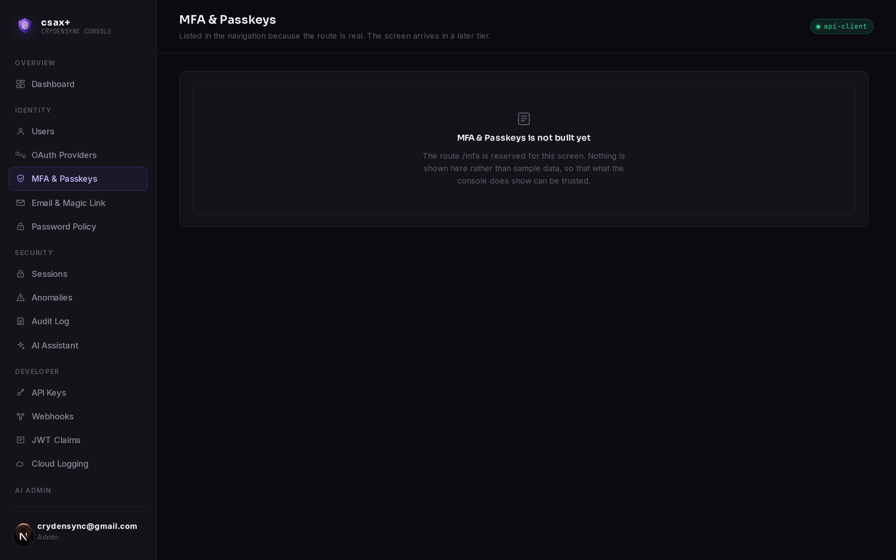
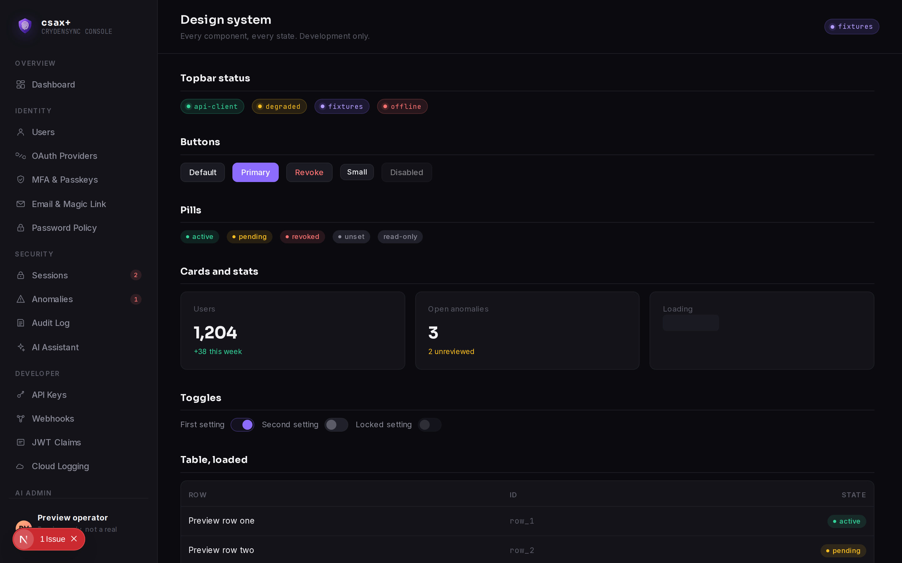
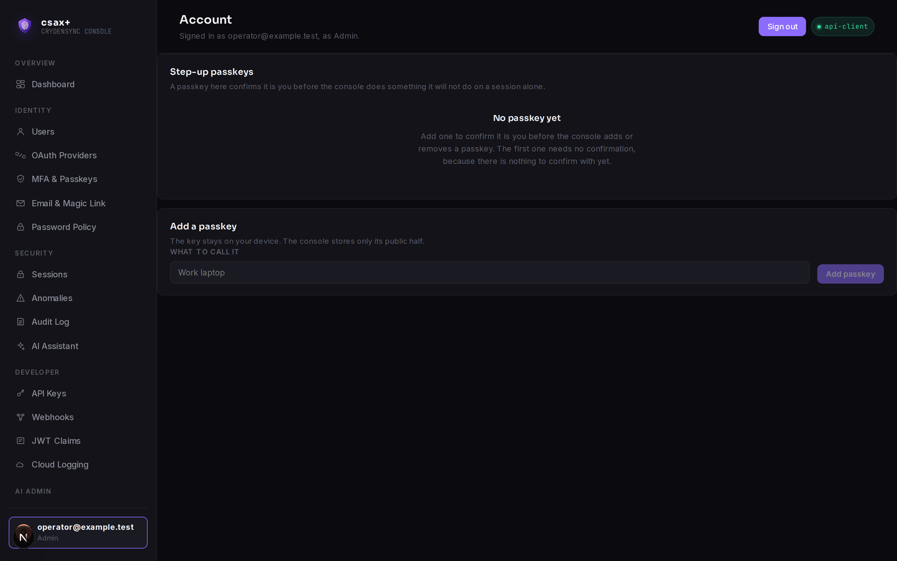

<p align="center">
  
</p>

<h1 align="center">csax+</h1>

<p align="center">
  The self-hosted admin console for <a href="https://github.com/crydensync/cryden">CrydenSync</a>,
  the embeddable authentication engine for Go.
</p>

<p align="center">
  
  
  
  
</p>

> **Status: tier 0 of 5.** The foundation is in place and runs: configuration, the console's own
> store, operator sign-in against the CrydenSync API, the API client with its health tag, the
> design system, the landing page, and the dashboard. Twenty of the 21 console screens are not
> built yet, and every one of them says so on screen rather than showing stand-in data. See
> [Feature status](#3-feature-status) for the honest per-screen picture, and
> [docs/build/PROGRESS.md](docs/build/PROGRESS.md) for what is being worked on now.

There is no CI badge above, and that is deliberate rather than an oversight: the GitHub Actions
workflow arrives in step 5.6. A badge pointing at a workflow that does not exist resolves to
nothing, and a badge that resolves to nothing is the kind of small untrue thing this project
avoids on its screens. Recorded in [docs/build/DECISIONS.md](docs/build/DECISIONS.md) as D15.

---

## 1. What csax+ is, and what it is not

**CrydenSync is a Go library.** You import it, wire it to your own database, and it gives you
sign-up, sign-in, sessions, MFA, passkeys, OAuth, API keys and an audit trail. It is
framework-agnostic and it ships no user interface. The shipped HTTP layer,
[`crydensync/api`](https://github.com/crydensync/api), exposes it under `/v1` and `/v1/admin`.

**csax+ is the console on top of that HTTP API.** It is what an operator opens when they would
rather see their users, sessions and audit log than write another `curl`.

What that means in practice:

- **Self-hosted, with no vendor in the loop.** Your users, sessions and audit entries stay in your
  database, on your infrastructure. csax+ holds no copy of them.
- **Zero telemetry.** No analytics SDK, no crash reporter, no phone-home. Fonts are self-hosted at
  build time, and the e2e suite fails if any request leaves the deployment's own origin.
- **API-first, never a mock wearing a console's clothes.** Every screen reads from the API or shows
  an honest state saying it cannot. A fixture is never a silent substitute for a call that failed.
- **AI that cannot write.** Every AI feature is read-only by construction: no AI code path holds a
  reference to anything that writes. See [the read-only guarantee](#9-security-model).

What csax+ is not:

- **Not an authentication server.** It authenticates its own operators and nobody else. Your
  application's users sign in through your application, backed by the engine.
- **Not a hosted service.** There is no csax+ cloud and no plan to make one.
- **Not a replacement for the API.** It is a client of it. Anything the API cannot answer, the
  console says it cannot answer, rather than reaching around it. The one exception is a
  SELECT-only database role used by the read-only AI query templates
  (`READONLY_DATABASE_URL`), which is documented in [section 7](#7-configuration-reference).
- **Not a way to hold your engine's credentials.** The console never receives the engine's primary
  `DATABASE_URL`. It talks to the API, which owns that connection.

---

## 2. Architecture



Four things about that picture are load-bearing:

1. **The browser never sees a token.** The operator's API tokens live inside an encrypted,
   `httpOnly` cookie. The BFF decrypts it, calls the API, and returns rendered HTML. A page script
   cannot read the cookie and there is no JavaScript-readable copy.
2. **The console has its own small store.** Passkeys for step-up, vault secrets, console audit
   entries and UI preferences go in `CSAX_STORE_URL`, with its own schema and its own database
   role. It is never the engine's primary database.
3. **The AI layer is separated by a credential, not by a promise.** When it lands in tier 4 it will
   reach the data through a SELECT-only role, and it will have no client for the API's mutation
   routes at all. Today the arrow is drawn and the module does not exist; the guarantee is in
   [section 8.1](#81-the-read-only-ai-guarantee).
4. **Nothing is stored twice.** Sessions, users and audit entries are read from the API and
   rendered, and the console keeps no shadow copy that could drift. The one API read that happens
   today is `GET /v1/sessions`, which the sign-in flow uses to learn which session it just created
   (see [BACKEND_GAPS 4.1](docs/build/BACKEND_GAPS.md)); it stores the id and nothing else.

---

## 3. Feature status

Three statuses, and they mean exactly this:

- **done**: it works, it was run, and a test holds it.
- **partial**: the route exists and renders, but the screen behind it is not the screen yet.
- **planned**: not built. Following its sidebar link opens a page that says so.

### 3.1 Platform

| Piece | Status | Notes |
|---|---|---|
| Configuration loader | done | env, then `<KEY>_FILE`, then `csax.config.json`, then defaults; boots fail fast with every problem listed at once |
| Console store and migrations | done | Postgres and SQLite, same schema, two drivers; both dialects execute in the test suite |
| Operator sign-in | done | `POST /v1/login` plus the paused-login completions and `/v1/refresh`; roles, CSRF, encrypted cookie |
| API client and health tag | done | `api-client`, `degraded`, `fixtures`, `offline`, each from a real answer |
| Admin reports | done | the four `/v1/admin` reads the dashboard needs, each parsed with zod before it is used |
| Design system | done | the prototype's tokens and components, ported to React |
| Landing page | done | static, and its claims are generated from the console's own navigation |
| Operator passkeys and step-up unlock | done | register, list and remove at `/account`, reached from the sidebar's operator chip; the first passkey needs no step-up, every one after and every removal does |
| Secrets vault | planned | tier 5, step 5.2 |
| Hardening and deployment | planned | tier 5, steps 5.5 and 5.6 |

### 3.2 Screens

The six sidebar groups, and all 21 screens in them.

| Group | Screen | Status | Arrives in |
|---|---|---|---|
| Overview | Dashboard | done | tier 1, step 1.1 |
| Identity | Users | partial | tier 1, step 1.2. The list, the exact-address search, the pager and the detail drawer read the API for real; the account actions need six endpoints the API does not have yet |
| Identity | OAuth Providers | planned | tier 1, step 1.3 |
| Identity | MFA & Passkeys | planned | tier 1, step 1.4 |
| Identity | Email & Magic Link | planned | tier 1, step 1.5 |
| Identity | Password Policy | planned | tier 1, step 1.6 |
| Security | Sessions | planned | tier 2, step 2.1 |
| Security | Anomalies | planned | tier 2, step 2.2 |
| Security | Audit Log | planned | tier 2, step 2.3 |
| Security | AI Assistant (read-only) | planned | tier 4, step 4.2 |
| Developer | API Keys | planned | tier 3, step 3.1 |
| Developer | Webhooks | planned | tier 3, step 3.2 |
| Developer | JWT Claims | planned | tier 3, step 3.3 |
| Developer | Cloud Logging | planned | tier 3, step 3.4 |
| AI Admin | Weekly Digest | planned | tier 4, step 4.3 |
| AI Admin | Support Assistant (read-only) | planned | tier 4, step 4.4 |
| AI Admin | Config Advisor (read-only) | planned | tier 4, step 4.5 |
| AI Admin | Ask-AI Widget (read-only) | planned | tier 4, step 4.6 |
| Configuration | LLM Provider | planned | tier 4, step 4.7 |
| Configuration | Database Provider | planned | tier 4, step 4.7 |
| Configuration | Settings & Secrets | planned | tier 5, step 5.2 |

Several of those need endpoints the API does not have yet. Every one is listed in
[docs/build/BACKEND_GAPS.md](docs/build/BACKEND_GAPS.md) with the evidence for it, and a screen
whose endpoint is missing shows a specific "not available in this deployment" state rather than an
empty table.

One screen is not in the table, because it is not in the sidebar's groups. **Account** (`/account`)
manages the operator's own step-up passkeys, and it is reached by clicking the operator chip at the
foot of the sidebar, the one already showing their address and role. It is left out of the
navigation on purpose: this page's console map is generated from that same list, so a screen added
to the sidebar would change what the landing page claims the console is.

**No endpoint is faked.** Where the API cannot answer, the console says so. Where a screen cannot
be built at all yet, its route renders the "not built yet" page shown below.

---

## 4. Screenshots

Regenerate them with `pnpm screenshots`, which drives a running dev server with Playwright and
writes into `docs/guide/screenshots/`. That command is separate from the e2e gate so a test run
never rewrites a committed image.

| | |
|---|---|
|  |  |
| The landing page at `/`. Its console map is generated from the console's own navigation. | The same page's console section, with the read-only tag on the four AI screens. |
|  |  |
| Operator sign-in. A second factor, when the account has one, is asked for on the next step. | The dashboard against a real API: the tag reads `api-client`, the numbers are that deployment's own, and the digest says plainly that no schedule is configured. |
|  |  |
| Users, against the same deployment, photographed through its own search: one exact address, the row that matched, and the API's own match mode named below the table. | Every screen that is still planned says so, and names its own route. |
|  |  |
| `/design`, the dev-only component gallery. It 404s in a production build. | The operator's own screen, reached from the chip at the foot of the sidebar: the passkeys that confirm it is them. |

The console screenshots are taken from a real sign-in: `pnpm screenshots` signs in with
`CSAX_SCREENSHOT_EMAIL` and `CSAX_SCREENSHOT_PASSWORD`, read from the environment or the gitignored
`.env.local`, so the account it photographs is a real account on a real API and no password is
written into a script. Without those variables it falls back to a session minted in the console's
own cookie format, whose API tokens are placeholders: that still photographs a signed-in shell, with
every API-backed report showing the state an unreachable API produces.

**Run it with the credentials or not at all.** The fallback rewrites the same files as the real
sign-in, so running it without them replaces the dashboard and Users images with those failure
states and commits a worse picture of a working console. `git diff` on
`docs/guide/screenshots/` before committing a run is the cheap check.

The Users shot is narrowed with the screen's own search to the account the run signed in as. The
list is every account the deployment holds, and a guide image should not publish the addresses of
accounts the reader has nothing to do with. The dashboard's newest-accounts table has no such
control, so its committed image is the one taken from a deployment holding sample data only.

---

## 5. Quick start

You need **Node 22 or newer** and **pnpm**. There is no build step to run first.

### 5.1 Offline, to look at the interface

This is the honest version of "try it without a backend": the console boots, the design system and
the landing page render, and the connection tag reads `fixtures`. **You cannot sign in**, because
sign-in is a real call to a real API and fixtures mode has no adapter for it. That is by design:
a console that let you "sign in" to sample data would be teaching you the wrong thing about it.

```bash
pnpm install
cp .env.example .env.local
# fill in CSAX_API_URL and two 32-byte base64 keys; openssl rand -base64 32 generates each
pnpm dev
```

Then open <http://localhost:3000>. `/design` shows every component in every state.

### 5.2 Against a real CrydenSync API

1. Stand up the API from [`crydensync/api`](https://github.com/crydensync/api) and run
   `api migrate`.
2. Make yourself an operator:
   ```bash
   go run ./cmd/grant-operator -db "$DATABASE_URL" -email "$OPERATOR_EMAIL"
   ```
   The `-role` flag defaults to `admin`; `-revoke` takes the grant away again.
3. Point csax+ at it and switch the mode:
   ```
   CSAX_API_URL=http://127.0.0.1:8080
   CRYDEN_MODE=live
   ```
4. `pnpm dev`, then sign in with that operator's address and password.

### 5.3 Docker Compose

Not yet. The image, the compose file and the Kubernetes manifest arrive in step 5.6, and this
section will be replaced with the real instructions then rather than describing a file that does
not exist.

---

## 6. Configuration

Every setting resolves in one order:

1. **the environment variable itself** (`CSAX_API_URL`)
2. **the `_FILE` indirection** (`CSAX_API_URL_FILE`), which names a file to read the value from.
   This is what a container secret mount uses. One trailing newline is trimmed.
3. **the disk config file**, `csax.config.json` by default, or the path in `CSAX_CONFIG_FILE`.
   Only JSON is parsed; a `.toml` path is refused rather than silently ignored.
4. **a documented default**, for non-sensitive settings only.

A blank environment value falls through to the next source, because an empty string in a `.env`
file almost always means "not set" rather than "deliberately empty". A value that is set but
invalid is the opposite: the console refuses to boot and prints every problem it found at once,
naming the key and the reason and never the value.

### 6.1 The full reference

| Environment variable | `_FILE` variant | Config file key | Default | Secret |
|---|---|---|---|---|
| `CSAX_API_URL` | yes | `CSAX_API_URL` | none, required | no |
| `CRYDEN_MODE` | yes | `CRYDEN_MODE` | `live` | no |
| `CSAX_STORE_URL` | yes | `CSAX_STORE_URL` | none | **yes** |
| `CSAX_STORE_SQLITE_PATH` | yes | `CSAX_STORE_SQLITE_PATH` | `.csaxplus/console.sqlite` | no |
| `READONLY_DATABASE_URL` | yes | `READONLY_DATABASE_URL` | none | **yes** |
| `CSAX_SESSION_SECRET` | yes | `CSAX_SESSION_SECRET` | none, required | **yes** |
| `CSAX_VAULT_KEY` | yes | `CSAX_VAULT_KEY` | none, required | **yes** |
| `WEBAUTHN_RP_ID` | yes | `WEBAUTHN_RP_ID` | none, required | no |
| `WEBAUTHN_RP_NAME` | yes | `WEBAUTHN_RP_NAME` | `csax+ console` | no |
| `WEBAUTHN_ORIGIN` | yes | `WEBAUTHN_ORIGIN` | none, required | no |
| `RESEND_API_KEY` | yes | `RESEND_API_KEY` | none | **yes** |
| `LLM_PROVIDER` | yes | `LLM_PROVIDER` | none | no |
| `ANTHROPIC_API_KEY` | yes | `ANTHROPIC_API_KEY` | none | **yes** |
| `OPENAI_API_KEY` | yes | `OPENAI_API_KEY` | none | **yes** |
| `LOG_LEVEL` | yes | `LOG_LEVEL` | `info` | no |
| `SKIP_AUTO_MIGRATE` | yes | `SKIP_AUTO_MIGRATE` | `0` | no |
| `CSAX_CONFIG_FILE` | n/a | n/a | `csax.config.json` | no |

A **secret** is masked everywhere it could surface: the boot failure message, the logs, and the
Settings screen's configuration view, which shows where each setting came from and never what it
is.

### 6.2 What the values mean

- **`CSAX_API_URL`.** Base URL of the CrydenSync API. The same name the CLI's API-client mode uses.
- **`CRYDEN_MODE`.** `live` calls `CSAX_API_URL`. `fixtures` serves labelled sample data for
  offline demos. It is never a fallback: a live call that fails stays a failure.
- **`CSAX_STORE_URL`** and **`CSAX_STORE_SQLITE_PATH`.** The console's own store. Exactly one of
  the two; setting both is a boot error rather than a coin toss. With neither, a local SQLite file
  under the working directory is used so a fresh checkout runs without a database.
- **`READONLY_DATABASE_URL`.** The SELECT-only role the read-only AI query templates run against.
  The only database credential any AI code path may hold.
- **`CSAX_SESSION_SECRET`.** Signs and encrypts the operator session cookie. 32 random bytes,
  base64. `openssl rand -base64 32`.
- **`CSAX_VAULT_KEY`.** AES-256-GCM key for secrets at rest. 32 random bytes, base64.
- **`WEBAUTHN_RP_ID`**, **`WEBAUTHN_RP_NAME`**, **`WEBAUTHN_ORIGIN`.** The relying party. `RP_ID` is
  a bare domain with no scheme and no port; `ORIGIN` is the full origin the browser sends. The
  console's route handlers refuse a request whose `Origin` is not this value, so a deployment
  reachable at two names must pick one.
- **`RESEND_API_KEY`.** For the Email screen's delivery stats and test send. Optional; the Email
  screen reports the key as absent rather than pretending.
- **`LLM_PROVIDER`.** `anthropic`, `openai`, `azure-openai` or `openai-compatible`.
- **`LOG_LEVEL`.** `error`, `warn`, `info` or `debug`. Validated and carried today; the logger that
  consumes it arrives in step 5.5.
- **`SKIP_AUTO_MIGRATE`.** Stops the console applying its own store migrations on boot.

A fuller walkthrough is in [docs/guide/configuration.md](docs/guide/configuration.md).

---

## 7. Secrets and biometric unlock

> **Status: designed, not built.** This section describes what tiers 1 to 5 will implement, and it
> is here so the design can be reviewed before the code exists. The one part that works today is
> the configuration loader's masking, which never prints a sensitive value.

**Storage.** Vault secrets live in the console's own store, encrypted with AES-256-GCM under
`CSAX_VAULT_KEY`. A provider's credential is either an environment variable, a file (through the
`_FILE` mount, which is what a container or a systemd `LoadCredential` gives you), or the vault.
The console reports which provider is in use per secret rather than assuming one.

**Masking.** The secrets list shows a name, a provider, a fingerprint and a last-rotated date. It
never shows the value on load. Revealing one is a deliberate act with a time limit: the value is
re-masked server-side after 20 seconds, and the reveal is written to the console's audit log with
who did it and when.

**Step-up before a reveal.** Revealing a secret is a WebAuthn user-verification, not a password
prompt. The console asks the operator to complete a passkey ceremony in the OS prompt, verifies
the assertion server-side against the credential registered in the console's own store, and only
then returns the value. This is genuine WebAuthn: a real Face ID, Touch ID, Windows Hello or
hardware-key assertion, not a password field wearing a fingerprint icon.

**Relying party settings per environment.** `WEBAUTHN_RP_ID` is the registrable domain, and it
must be stable: a passkey registered under one RP ID cannot be used under another. `localhost` is
allowed over plain HTTP for development; anything else needs HTTPS, and browsers enforce that.

**Authenticators supported.** Any platform authenticator (Face ID, Touch ID, Windows Hello) and
any roaming security key, through the platform's own WebAuthn implementation. The console does not
maintain an allowlist of devices.

**Recovery for a lost passkey.** Two routes, both real:

1. **A second passkey.** Enrolling two is encouraged and the console says so in the enrolment flow.
   Losing one device is then not a lockout.
2. **`go run ./cmd/grant-operator`** against the API's database, which is the break-glass path and
   deliberately not reachable from the console. It is the same command that creates the first
   operator, so the recovery procedure is a procedure you have already practised.

There is no email-based recovery for a lost passkey, because that would make the operator's email
the weakest link in a system whose whole point is not being the weakest link.

Read [docs/guide/secrets-and-passkeys.md](docs/guide/secrets-and-passkeys.md) for the fuller
design.

---

## 8. Security model

### 8.1 The read-only AI guarantee

> **Status: the guarantee is a design rule today, and code tomorrow.** The AI layer arrives in
> tier 4. What exists now is the rule itself, and the one place it is already visible: the landing
> page's console map tags the four AI screens `read-only`, from a flag on the navigation entry
> rather than from a hand-written label.

**No AI feature may hold a reference to any write path.** Not a method it declines to call, not a
tool with a disabled flag: no reference at all. Concretely, when tier 4 lands:

- The AI layer reaches data through `READONLY_DATABASE_URL`, a SELECT-only role, and through
  allowlisted query templates rather than generated SQL.
- It gets its own API client, a different module from the one the console's own screens use, and
  the mutation methods are **absent** from it rather than present and discouraged.
- The LLM Provider screen's write toggle is locked off and stays locked off.
- The Ask-AI widget **discards any identity filter the model produces and substitutes the verified
  user id from the caller's token, unconditionally.** A model that is asked about one user cannot
  answer about another, because its output never carries the filter in the first place.
- The invariant is held by tests, including an adversarial suite that tries to talk the widget into
  acting on another account. Step 4.6 is where that suite is written.

The read-only flag lives on the navigation entry (`NavItem.readOnly` in `src/lib/nav.ts`) so that
the tag has one source and cannot be added to a screen that is not read-only, or forgotten on one
that is. The sidebar will draw it when the AI screens are built.

### 8.2 What is logged, and what never is

> **Status: the never-logged half is true today; the logged half is the target.** The console's own
> logger arrives in step 5.5, and today it writes three boot lines and nothing else, all through
> `console.info` / `console.error`. Nothing logs a request, an operator action or an audit entry
> yet, and `LOG_LEVEL` is validated and carried but not yet consumed. Stated plainly because a
> security section that describes a logger nobody has written is the most misleading kind of
> documentation.

**The target.** Logged: operator sign-in attempts and their outcome, session revocation, secret
reveals and rotations, every console mutation, and the console's own audit entries.

**Never logged, and true now:** secrets, tokens, passwords, cookies, CSRF values, vault plaintext,
or a configuration value for any setting marked secret in
[section 6.1](#61-the-full-reference). A boot failure names the key and the reason and never the
value, because a configuration error is exactly the moment a secret is most likely to end up in a
log aggregator. That is enforced today by construction: the only thing the console prints at boot
is a list of key names and reasons, and no code path passes a resolved value to a message.

### 8.3 Defaults the console holds itself to

- An encrypted session cookie: `httpOnly`, `SameSite=Lax`, `Secure` in production, and a separate
  audience for the paused-login cookie so one can never stand in for the other.
- CSRF on every mutation, through a double-submit value read from the session endpoint and never
  embedded in a page.
- `zod` validation on every route handler's input.
- Constant-time comparison for anything compared against a secret.
- No `innerHTML` with anything that came from outside the console.
- A strict Content Security Policy, in production, from step 5.5.

### 8.4 Threat model in one paragraph

The console is deployed inside your perimeter, reached by your operators, and trusted with
nothing that the API does not already trust them with: it holds no signing key, verifies no token
itself, and makes no authorisation decision of its own. The API is the authority on every call.
The console's job is to not leak what passes through it and to not let an AI feature do anything a
person could not. The interesting attackers are therefore an operator who has been phished (which
step-up and a short session lifetime limit), a stolen session cookie (which encryption,
`httpOnly`, and revocation limit), and a prompt that tries to make the assistant act outside its
scope (which the absence of a write path makes impossible rather than unlikely).

### 8.5 Reporting a vulnerability

See [SECURITY.md](SECURITY.md). Please do not open a public issue for a vulnerability.

---

## 9. Deployment

> **Status: not built.** The Dockerfile, the Compose file, the Kubernetes manifest and the CI
> workflow arrive in step 5.6. Today the console runs from a checkout with `pnpm dev` or
> `pnpm build && pnpm start`. This section will be replaced with real, tested instructions when
> those files exist, rather than describing files that do not.

What is already true and worth knowing before then:

- The production build is `output: "standalone"`, so the server ships as a self-contained bundle
  with `node_modules` pruned to what it actually uses.
- `/` is the only statically rendered route. Everything under `(console)` reads the session and is
  therefore dynamic, which is correct: it differs per operator.
- A production boot requires `CSAX_API_URL`, `CSAX_SESSION_SECRET` and `CSAX_VAULT_KEY` at minimum,
  and refuses to start without them, naming what is missing.
- `Secure` cookies are forced in production, and `WEBAUTHN_ORIGIN` must be the HTTPS origin the
  operator actually uses, or sign-in is refused by design.

A fuller sketch of the intended shape is in [docs/guide/deployment.md](docs/guide/deployment.md).

---

## 10. Backend compatibility and known gaps

- **Postgres 13 or newer.** The engine uses the built-in `gen_random_uuid()`, so 13 is the floor.
- **SQLite works for the engine, not for this console's tables.** The engine supports signup,
  sign-in, refresh, sessions, password and email change, OAuth, TOTP, passkeys, recovery codes,
  magic links and API keys on SQLite. Every `/v1/admin/*` route answers
  `501 not_implemented_on_sqlite` without even inspecting the token. The console turns that into a
  clear state rather than a broken screen.
- **The console's reads are all operator reads.** `RequireAdmin` refuses any token whose `role`
  claim is not literally `admin`, and it deliberately does not say whether the account was never an
  operator, was one and was revoked, or is an ordinary user. The console's `viewer` role can sign in
  and currently reads nothing; the dashboard says so in one sentence rather than four. See
  [docs/build/BACKEND_GAPS.md](docs/build/BACKEND_GAPS.md) 4.7.
- **The console's own store is separate** and may be either engine, independently of what the API
  uses. Its Postgres migrations and queries are executed in the test suite against a real Postgres:
  PGlite behind `@electric-sql/pglite-socket`, a development dependency, serving the wire protocol to
  the same `openPostgresStore` a deployment uses. The built server is booted against it as well. See
  [docs/guide/setup.md](docs/guide/setup.md).

Every gap between what a screen wants and what the API provides is written down, with the file and
line that proves it, in **[docs/build/BACKEND_GAPS.md](docs/build/BACKEND_GAPS.md)**. That file also
records the places where the original prototype promised something the engine does not do, which
is a different and more interesting list: a "rehash on next login" toggle describing behaviour that
does not exist, a password-history rule with no engine support, a `csax` CLI that is nowhere in
either repository, and webhook delivery described as an unimplemented interface when the API in
fact implements it.

---

## 11. Development

### 11.1 Layout

```
src/
  app/                    routes
    page.tsx              the landing page (static)
    login/                operator sign-in
    (console)/            everything behind a session, with the sidebar frame
    design/               dev-only component gallery, 404s in production
    api/                  route handlers (the BFF)
  components/             the design system: Card, Button, DataTable, Modal, Toast, states
  lib/                    shared, dependency-free helpers and the navigation
  server/
    auth/                 cookie sealing, CSRF, roles, the API transport, the sign-in flow
    config/               the loader: sources, validation, provenance
    cryden/               the API client and its two adapters
    db/                   the console store: schema, migrations, drivers
docs/
  guide/                  user-facing docs and screenshots
  build/                  PROGRESS.md, DECISIONS.md, BACKEND_GAPS.md
tests/
  unit/                   vitest
  e2e/                    playwright, the gate
  screenshots/            playwright, run by hand with pnpm screenshots
```

### 11.2 Scripts

| Command | What it does |
|---|---|
| `pnpm dev` | dev server on <http://localhost:3000> |
| `pnpm build` | production build |
| `pnpm start` | serve the production build |
| `pnpm lint` | ESLint |
| `pnpm typecheck` | `tsc --noEmit` |
| `pnpm test` | vitest, unit tests |
| `pnpm test:e2e` | playwright, the gate; starts a dev server if one is not already up |
| `pnpm screenshots` | regenerates `docs/guide/screenshots/` |
| `pnpm format` | prettier |

### 11.3 The verification gate

Before every commit:

```bash
pnpm lint && pnpm typecheck && pnpm test
```

plus `pnpm test:e2e` for anything touching the UI or authentication. A step is not done until run
the app, open the screen, and check the loading, empty, error and success states, the keyboard path
and focus rings, and a 375 pixel viewport.

### 11.4 Adding a screen

1. Add the route under `src/app/(console)/`. It takes precedence over the catch-all that renders
   the "not built yet" page.
2. Add an entry to `NAV_GROUPS` in `src/lib/nav.ts` if it is not there yet. The sidebar and the
   landing page's console map both read that array, so there is one place to change.
3. Call the API through `crydenClient()`. If the endpoint does not exist, stop and add it to
   `docs/build/BACKEND_GAPS.md` first, then render a specific "not available in this deployment"
   state. Do not invent a shape and do not reach past the API.
4. Give the screen its own loading, empty and error states. A screen that has only a success state
   has not been finished.
5. Write the e2e test with the screen, not after it.

### 11.5 Commit conventions

[Conventional Commits](https://www.conventionalcommits.org/), enforced by a `commit-msg` hook and
commitlint. Subjects are at most 72 characters. There is no co-author trailer and no tool
attribution in this repository's history, also enforced by the hook.

One further rule is held by `tests/unit/no-forbidden-characters.test.ts`: no em dashes and no en
dashes anywhere in the files this project authors, built from code points so the test file does not
itself contain what it forbids. The commit hook rejects them in commit messages too.

---

## 12. Contributing

Bug reports, screen work and documentation fixes are all welcome. Read
[CONTRIBUTING.md](CONTRIBUTING.md) first; it covers the gate, the house style and what a good pull
request looks like here. Everyone taking part is held to the
[Code of Conduct](CODE_OF_CONDUCT.md).

The most useful contribution today is the unglamorous one: a screen whose endpoint exists but
which no tier has built yet. Section 3.2 says which those are.

---

## 13. License and links

MIT. See [LICENSE](LICENSE).

- The engine: [github.com/crydensync/cryden](https://github.com/crydensync/cryden)
- The HTTP API: [github.com/crydensync/api](https://github.com/crydensync/api)
- Build notes: [docs/build/PROGRESS.md](docs/build/PROGRESS.md),
  [docs/build/DECISIONS.md](docs/build/DECISIONS.md),
  [docs/build/BACKEND_GAPS.md](docs/build/BACKEND_GAPS.md)
- Changelog: [CHANGELOG.md](CHANGELOG.md)

<p align="center">Built in Africa with love. Own your users, not vendor lock-in.</p>
